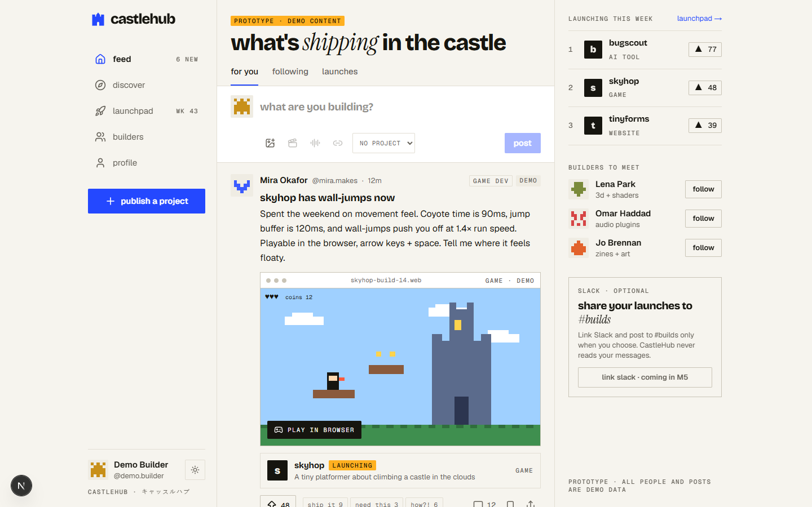
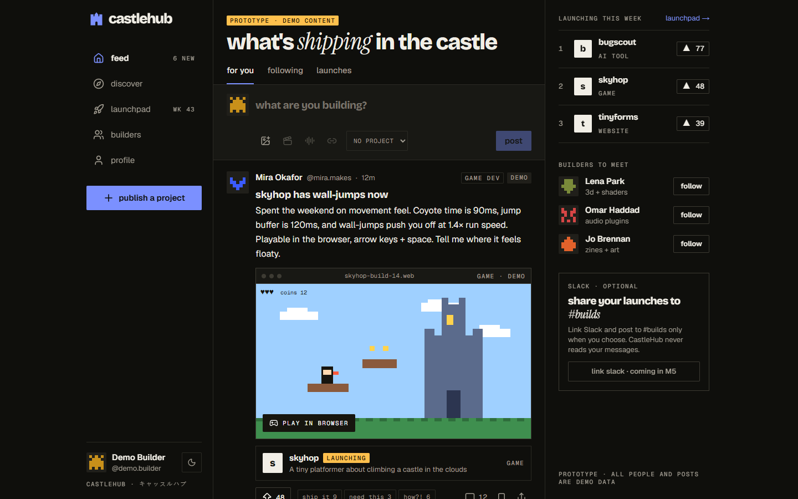
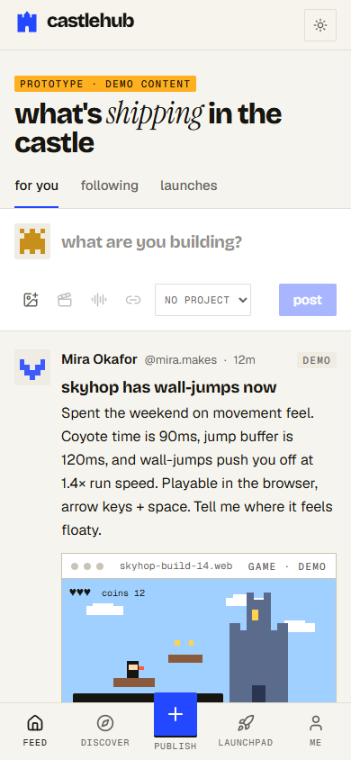
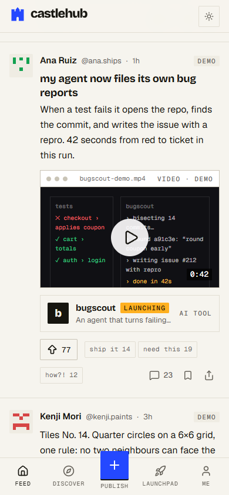
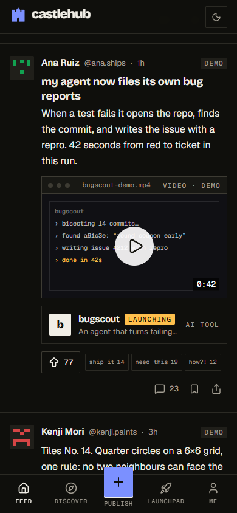

<p align="center">
  
</p>

<h1 align="center">castlehub</h1>

<p align="center">
  <b>A social home for the SkyCastle builder community.</b><br />
  Post work in progress, launch projects, and get seen by people who build too.
</p>

<p align="center">
  
  
  
  
</p>

---

## What is CastleHub?

CastleHub is where SkyCastle builders show what they're making: games, websites, AI tools, music, art and video. It sits somewhere between Product Hunt (launches and upvotes) and a social feed (the messy middle of a build), with a profile for every builder.

- **Post the messy middle:** share clips, tracks, screenshots and questions while the work is still in progress.
- **Launch when it's ready:** give a project its own page, then enter the weekly **Launchpad** or let people find it in **Discover**.
- **Find your people:** upvotes, comments and builder reactions ("ship it", "need this", "how?!").
- **Slack, only if you want it:** link Slack and share a launch to `#builds` yourself. CastleHub never scrapes the workspace or reads messages.

## Status

> **Prototype.** The landing page and the feed are high-fidelity prototypes. Every person, post and number in them is **demo data**, clearly labelled, and nothing is saved yet. Sign-in, profiles and project publishing come next (see [Roadmap](#roadmap)).

| Route | What it is |
| --- | --- |
| `/` | Landing page with a live, scrollable feed window over the castle |
| `/feed` | Feed prototype: composer, media posts, reactions, three-column layout |

## Screenshots

| Desktop, light | Desktop, dark |
| --- | --- |
|  |  |

| Phone, light | Phone, scrolled | Phone, dark |
| --- | --- | --- |
|  |  |  |

## Getting started

Requires **Node.js 20+** (developed on Node 24) and npm.

```bash
git clone https://github.com/AboubakarArisar/castlehub.git
cd castlehub
npm install
npm run dev
```

Open http://localhost:3000 for the landing page and http://localhost:3000/feed for the feed.

| Script | What it does |
| --- | --- |
| `npm run dev` | Start the dev server (Turbopack) |
| `npm run build` | Production build |
| `npm run start` | Serve the production build |
| `npm run lint` | Run ESLint |
| `npm test` | Unit tests (rules, formatting, build streak logic) |
| `npm run test:db` | Database tests for build streaks. Needs a throwaway local Postgres; refuses any non-localhost `DATABASE_URL` |

For a local database, `npx prisma dev` starts one. It serves one connection at a time, so also set `DATABASE_POOL_MAX=1` when running the app against it.

No environment variables are needed for the prototype. Database, sign-in and Slack settings will be documented in `.env.example` when those milestones land.

## Tech stack

| Area | Choice |
| --- | --- |
| Framework | Next.js 16 (App Router), React 19, TypeScript |
| Styling | Tailwind CSS 4, shadcn/ui, lucide-react icons |
| Fonts | Bricolage Grotesque, Instrument Serif, Geist, Geist Mono (all SIL OFL, via `next/font`) |
| Data *(planned)* | PostgreSQL with Prisma 7 |
| Auth *(planned)* | Auth.js with GitHub sign-in; Slack as an optional linked account |
| Validation *(planned)* | Zod, shared by forms and Server Actions |

## Design system: "Sky Workshop"

CastleHub's look is its own: inspired by SkyCastle's sharp, builder-first energy and by the expressive type of HeyClicky and buildspace, without copying any of them.

- **Type:** heavy lowercase **Bricolage Grotesque** for titles, one **Instrument Serif** italic word for emphasis, **Geist** for anything you read, **Geist Mono** for uppercase labels and counts.
- **Colour:** warm paper and ink neutrals, **cobalt** `#2448FF` for actions, **amber** `#FFB020` for upvotes and launches. No gradients. Every text pair meets WCAG AA in light and dark.
- **Shape:** 2px corners on controls, square media frames with a mono title bar (like desktop windows), hairline dividers instead of stacks of rounded cards.
- **Motion:** 120ms hovers, an upvote count that rolls, reaction stamps. All of it respects `prefers-reduced-motion`.
- **Layout:** three columns on desktop, an icon rail on tablets, a bottom tab bar on phones.

Tokens live in [`src/app/globals.css`](src/app/globals.css).

## Project structure

```
src/
├─ app/
│  ├─ page.tsx            # landing page
│  ├─ feed/page.tsx       # feed prototype
│  ├─ layout.tsx          # fonts, theme cookie
│  └─ globals.css         # design tokens + type scale
├─ components/
│  ├─ landing-hero.tsx    # hero: headline, castle stage, live app window
│  ├─ shell.tsx           # three-column app shell + phone bottom bar
│  ├─ composer.tsx        # post composer
│  ├─ post.tsx            # feed post
│  ├─ media.tsx           # media windows: game, music, video, website, art
│  ├─ reactions.tsx       # upvote + reaction stamps
│  ├─ avatar.tsx          # pixel avatars seeded by handle
│  ├─ logo.tsx            # tower mark + wordmark
│  ├─ theme-toggle.tsx
│  └─ ui/                 # shadcn/ui primitives
└─ lib/
   └─ demo.ts             # demo data (to be replaced by real content)
docs/                     # screen plan PDF and prototype screenshots
```

## Roadmap

| Milestone | Scope |
| --- | --- |
| **M1 Foundation** | PostgreSQL + Prisma, Auth.js sign-in, app shell, labelled demo seed |
| **M2 Profiles** | Claim a handle, public builder profile, edit profile, avatar upload |
| **M3 Publishing** | Publish and edit projects, image uploads, validation, ownership checks, project page |
| **M4 Discovery** | Discover (filter by type, sort), opt-in weekly Launchpad, upvotes |
| **M5 Slack** | Link Slack, share to `#builds`, link existing Slack threads |
| **M6 Community** | Real feed posts, comments, search |
| **Later** | Hackathons, project version history, collaboration matching |

## Principles

- **Demo data stays labelled** until real members join, then it goes.
- **Slack is opt-in and user-initiated.** No workspace scraping, no reading DMs or private channels, no automatic posting.
- **Every edit checks ownership on the server**, never only in the UI.
- **Accessible by default:** named controls, visible focus, AA contrast, reduced-motion support.

## Credits

Built for the [SkyCastle](https://skycastle.ai) community. The CastleHub mark and design system are original; the reference sites were used for inspiration only.
